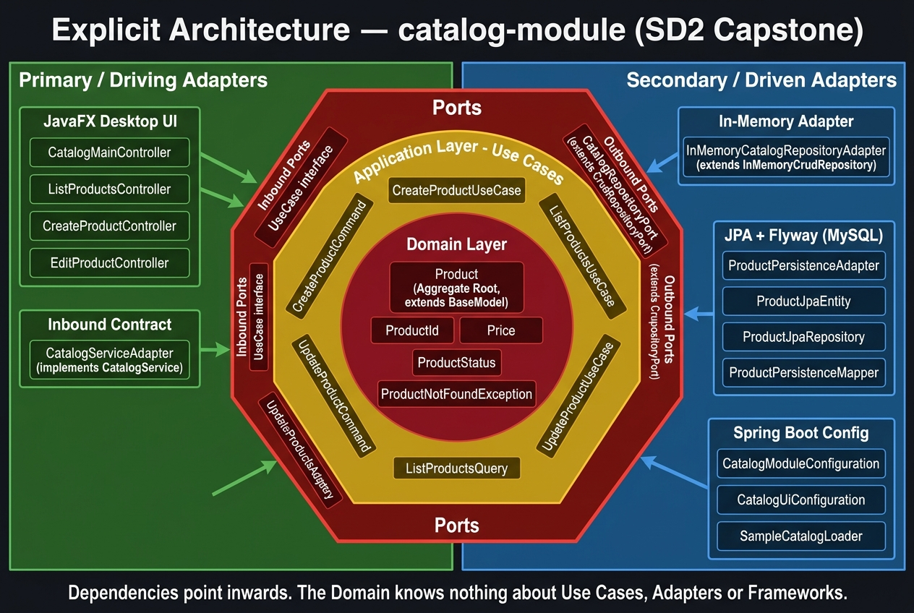

# Guia de Implementacion Paso a Paso: Vertical Slice de Catalogo

Esta guia describe la construccion del modulo de catalogo (`catalog-module`), avanzando capa por capa desde el dominio puro hasta la interfaz de usuario en JavaFX.

El objetivo didactico es tomar como espejo la implementacion de `user-module` y replicar cada una de sus piezas en el contexto de **Productos**. Para evitar distracciones de relaciones anidadas, asumimos que todos los productos pertenecen al comercio muestra predefinido en `core-module` (`SAMPLE_COMMERCE`), logrando una correspondencia 1 a 1 exacta con lo que ya conocemos de usuarios.

---

## Modelo Arquitectonico de Referencia

Para entender como se articulan las 8 capas de esta guia, tomamos como referencia el diagrama unificado de **Arquitectura Explicita** propuesto por Herberto Graca en su articulo [*Explicit Architecture (01: DDD, Hexagonal, Onion, Clean, CQRS - How I put it all together)*](https://herbertograca.com/2017/11/16/explicit-architecture-01-ddd-hexagonal-onion-clean-cqrs-how-i-put-it-all-together/):



### Mapeo con nuestras capas:
- **Core / Nucleo Central (Dominio):** `Capa 1` (Entidades, Value Objects, Excepciones de Dominio). No tiene dependencias externas.
- **Anillo de Aplicacion:** `Capa 3` (Casos de Uso) y `Capa 2` (Puertos de Entrada y Salida). Orquestan la logica del negocio y definen los contratos abstractos.
- **Anillo Exterior (Adaptadores e Infraestructura):** 
  - *Adaptadores de Salida:* `Capa 4` (Persistencia en Memoria) y `Capa 5` (Persistencia JPA + Flyway).
  - *Adaptadores de Entrada:* `Capa 6` (Contrato `CatalogService`) y `Capa 7` (Vistas y Controladores JavaFX).
  - *Inyeccion y Cableado:* `Capa 8` (Configuracion Spring Boot con `@Bean`).

---

## Indice de Capas

1. [Capa 1: Dominio Puro](#capa-1-dominio-puro)
2. [Capa 2: Aplicacion — Puertos](#capa-2-aplicacion--puertos)
3. [Capa 3: Aplicacion — Casos de Uso](#capa-3-aplicacion--casos-de-uso)
4. [Capa 4: Persistencia en Memoria](#capa-4-persistencia-en-memoria)
5. [Capa 5: Persistencia Real (JPA + Flyway)](#capa-5-persistencia-real-jpa--flyway)
6. [Capa 6: Integracion con el Contrato de Core](#capa-6-integracion-con-el-contrato-de-core)
7. [Capa 7: Interfaz Grafica JavaFX](#capa-7-interfaz-grafica-javafx)
8. [Capa 8: Cableado en Spring Boot](#capa-8-cableado-en-spring-boot)

---

## Capa 1: Dominio Puro

*Ubicacion: `src/main/java/org/jala/edu/catalog/domain/`*
*Regla de oro: Java puro. No usamos Spring, ni JavaFX, ni anotaciones de base de datos.*

### 1.1 `ProductId` (Value Object de Identidad)

*Ruta: `domain/model/ProductId.java`*

Envuelve un `UUID` para garantizar tipado fuerte y evitar el uso de primitivos genericos.

```java
package org.jala.edu.catalog.domain.model;

import java.util.Objects;
import java.util.UUID;

public record ProductId(UUID value) {

    public ProductId {
        Objects.requireNonNull(value, "Product id cannot be null");
    }

    public static ProductId newId() {
        return new ProductId(UUID.randomUUID());
    }

    public static ProductId of(String value) {
        return new ProductId(UUID.fromString(value));
    }

    @Override
    public String toString() {
        return value.toString();
    }
}
```

### 1.2 `Price` (Value Object Monetario)

*Ruta: `domain/model/Price.java`*

Protege la regla de que ningun precio puede ser nulo, negativo o tener redondeos inconsistentes.

```java
package org.jala.edu.catalog.domain.model;

import java.math.BigDecimal;
import java.math.RoundingMode;
import java.util.Objects;
import org.jala.edu.core.domain.exception.DomainException;

public record Price(BigDecimal value) {

    public Price {
        Objects.requireNonNull(value, "Price cannot be null");
        if (value.compareTo(BigDecimal.ZERO) < 0) {
            throw new DomainException("Price cannot be negative: " + value);
        }
        value = value.setScale(2, RoundingMode.HALF_UP);
    }

    public static Price of(double value) {
        return new Price(BigDecimal.valueOf(value));
    }

    public static Price of(String value) {
        try {
            return new Price(new BigDecimal(value));
        } catch (NumberFormatException e) {
            throw new DomainException("Invalid price format: " + value);
        }
    }

    @Override
    public String toString() {
        return value.toString();
    }
}
```

### 1.3 `Stock` (Value Object de Inventario)

*Ruta: `domain/model/Stock.java`*

Encapsula el inventario. Al ser inmutable, los metodos `decrease` e `increase` devuelven nuevas instancias protegidas contra valores negativos.

```java
package org.jala.edu.catalog.domain.model;

import org.jala.edu.core.domain.exception.ConflictException;
import org.jala.edu.core.domain.exception.DomainException;

public record Stock(int value) {

    public Stock {
        if (value < 0) {
            throw new DomainException("Stock cannot be negative: " + value);
        }
    }

    public static Stock zero() {
        return new Stock(0);
    }

    public static Stock of(int value) {
        return new Stock(value);
    }

    public boolean hasEnough(int quantity) {
        if (quantity < 0) {
            throw new DomainException("Requested quantity cannot be negative: " + quantity);
        }
        return value >= quantity;
    }

    public Stock decrease(int quantity) {
        if (!hasEnough(quantity)) {
            throw new ConflictException("Insufficient stock. Available: " + value + ", requested: " + quantity);
        }
        return new Stock(value - quantity);
    }

    public Stock increase(int quantity) {
        if (quantity < 0) {
            throw new DomainException("Quantity to add cannot be negative: " + quantity);
        }
        return new Stock(value + quantity);
    }

    @Override
    public String toString() {
        return String.valueOf(value);
    }
}
```

### 1.4 `ProductStatus` (Ciclo de Vida)

*Ruta: `domain/model/ProductStatus.java`*

```java
package org.jala.edu.catalog.domain.model;

public enum ProductStatus {
    ACTIVE,
    INACTIVE
}
```

### 1.5 `ProductNotFoundException` (Excepcion de Dominio)

*Ruta: `domain/exception/ProductNotFoundException.java`*

```java
package org.jala.edu.catalog.domain.exception;

import org.jala.edu.catalog.domain.model.ProductId;
import org.jala.edu.core.domain.exception.NotFoundException;

public class ProductNotFoundException extends NotFoundException {

    public ProductNotFoundException(ProductId id) {
        super("Product not found: " + id);
    }
}
```

### 1.6 `Product` (Aggregate Root)

*Ruta: `domain/model/Product.java`*

Hereda de `BaseModel<ProductId>` para recibir gestion de identidad y auditoria temporal automatica. No tiene setters publicos; el estado solo muta a traves de metodos de comportamiento que invocan `touch()`.

```java
package org.jala.edu.catalog.domain.model;

import java.time.Instant;
import java.util.Objects;
import java.util.UUID;
import lombok.Getter;
import lombok.ToString;
import org.jala.edu.core.domain.exception.ConflictException;
import org.jala.edu.core.domain.exception.DomainException;
import org.jala.edu.core.domain.model.BaseModel;

@Getter
@ToString(callSuper = true)
public class Product extends BaseModel<ProductId> {

    private final UUID commerceId;
    private String name;
    private String description;
    private Price price;
    private Stock stock;
    private ProductStatus status;

    private Product(ProductId id, UUID commerceId, String name, String description, Price price,
                    Stock stock, ProductStatus status, Instant createdAt, Instant updatedAt) {
        super(id, createdAt, updatedAt);
        this.commerceId = Objects.requireNonNull(commerceId, "Commerce id is required");
        this.name = requireText(name, "Name");
        this.description = description == null ? "" : description.strip();
        this.price = Objects.requireNonNull(price, "Price is required");
        this.stock = Objects.requireNonNull(stock, "Stock is required");
        this.status = Objects.requireNonNull(status, "Status is required");
    }

    public static Product register(UUID commerceId, String name, String description, Price price, Stock stock) {
        Instant now = now();
        return new Product(ProductId.newId(), commerceId, name, description, price, stock, ProductStatus.ACTIVE, now, now);
    }

    public static Product restore(ProductId id, UUID commerceId, String name, String description, Price price,
                                  Stock stock, ProductStatus status, Instant createdAt, Instant updatedAt) {
        return new Product(id, commerceId, name, description, price, stock, status, createdAt, updatedAt);
    }

    public void updateDetails(String name, String description, Price price) {
        this.name = requireText(name, "Name");
        this.description = description == null ? "" : description.strip();
        this.price = Objects.requireNonNull(price, "Price is required");
        touch();
    }

    public void updateStock(Stock stock) {
        this.stock = Objects.requireNonNull(stock, "Stock is required");
        touch();
    }

    public void reserveStock(int quantity) {
        if (!isActive()) {
            throw new ConflictException("Cannot reserve stock for inactive product: " + name);
        }
        this.stock = this.stock.decrease(quantity);
        touch();
    }

    public void releaseStock(int quantity) {
        this.stock = this.stock.increase(quantity);
        touch();
    }

    public void activate() {
        this.status = ProductStatus.ACTIVE;
        touch();
    }

    public void deactivate() {
        this.status = ProductStatus.INACTIVE;
        touch();
    }

    public boolean isActive() {
        return status == ProductStatus.ACTIVE;
    }

    public boolean isAvailable(int quantity) {
        return isActive() && stock.hasEnough(quantity);
    }

    private static String requireText(String value, String field) {
        if (value == null || value.isBlank()) {
            throw new DomainException(field + " cannot be blank");
        }
        return value.strip();
    }
}
```

---

## Capa 2: Aplicacion — Puertos

*Ubicacion: `src/main/java/org/jala/edu/catalog/application/port/`*

### 2.1 Puerto de Salida: `CatalogRepositoryPort`

*Ruta: `port/out/CatalogRepositoryPort.java`*

Hereda las operaciones genericas (`save`, `findById`, `findAll`, `deleteById`, `existsById`) de `CrudRepositoryPort` y anade las consultas que el catalogo requiere.

```java
package org.jala.edu.catalog.application.port.out;

import java.util.UUID;
import org.jala.edu.catalog.domain.model.Product;
import org.jala.edu.catalog.domain.model.ProductId;
import org.jala.edu.core.application.port.out.CrudRepositoryPort;

public interface CatalogRepositoryPort extends CrudRepositoryPort<Product, ProductId> {

    boolean existsByNameAndCommerceId(String name, UUID commerceId);
}
```

### 2.2 Puertos de Entrada: Comandos y Consultas

*Ruta: `port/in/CreateProductCommand.java`*

```java
package org.jala.edu.catalog.application.port.in;

import java.math.BigDecimal;
import java.util.UUID;

public record CreateProductCommand(
        UUID commerceId,
        String name,
        String description,
        BigDecimal price,
        int initialStock
) {
}
```

*Ruta: `port/in/UpdateProductCommand.java`*

```java
package org.jala.edu.catalog.application.port.in;

import java.math.BigDecimal;
import java.util.UUID;
import org.jala.edu.catalog.domain.model.ProductStatus;

public record UpdateProductCommand(
        UUID id,
        String name,
        String description,
        BigDecimal price,
        int stock,
        ProductStatus status
) {
}
```

*Ruta: `port/in/ListProductsQuery.java`*

```java
package org.jala.edu.catalog.application.port.in;

public record ListProductsQuery() {
}
```

---

## Capa 3: Aplicacion — Casos de Uso

*Ubicacion: `src/main/java/org/jala/edu/catalog/application/usecase/`*
*Regla: Implementan `UseCase<Input, Output>` de core. Cero anotaciones Spring.*

### 3.1 `CreateProductUseCase`

*Ruta: `usecase/CreateProductUseCase.java`*

```java
package org.jala.edu.catalog.application.usecase;

import java.util.UUID;
import org.jala.edu.catalog.application.port.in.CreateProductCommand;
import org.jala.edu.catalog.application.port.out.CatalogRepositoryPort;
import org.jala.edu.catalog.domain.model.Price;
import org.jala.edu.catalog.domain.model.Product;
import org.jala.edu.catalog.domain.model.Stock;
import org.jala.edu.core.application.usecase.UseCase;
import org.jala.edu.core.domain.exception.ConflictException;

public class CreateProductUseCase implements UseCase<CreateProductCommand, UUID> {

    private final CatalogRepositoryPort catalogRepository;

    public CreateProductUseCase(CatalogRepositoryPort catalogRepository) {
        this.catalogRepository = catalogRepository;
    }

    @Override
    public UUID execute(CreateProductCommand command) {
        Product newProduct = this.catalogRepository.save(newModel(command));
        return newProduct.getId().value();
    }

    public Product newModel(CreateProductCommand command) {
        String trimmedName = command.name() == null ? "" : command.name().strip();
        if (catalogRepository.existsByNameAndCommerceId(trimmedName, command.commerceId())) {
            throw new ConflictException("A product named '" + trimmedName + "' already exists in this commerce");
        }
        return Product.register(
                command.commerceId(),
                command.name(),
                command.description(),
                new Price(command.price()),
                Stock.of(command.initialStock())
        );
    }
}
```

### 3.2 `ListProductsUseCase`

*Ruta: `usecase/ListProductsUseCase.java`*

```java
package org.jala.edu.catalog.application.usecase;

import java.util.List;
import org.jala.edu.catalog.application.port.in.ListProductsQuery;
import org.jala.edu.catalog.application.port.out.CatalogRepositoryPort;
import org.jala.edu.catalog.domain.model.Product;
import org.jala.edu.core.application.usecase.UseCase;

public class ListProductsUseCase implements UseCase<ListProductsQuery, List<Product>> {

    private final CatalogRepositoryPort catalogRepository;

    public ListProductsUseCase(CatalogRepositoryPort catalogRepository) {
        this.catalogRepository = catalogRepository;
    }

    @Override
    public List<Product> execute(ListProductsQuery query) {
        return catalogRepository.findAll();
    }
}
```

### 3.3 `UpdateProductUseCase`

*Ruta: `usecase/UpdateProductUseCase.java`*

```java
package org.jala.edu.catalog.application.usecase;

import org.jala.edu.catalog.application.port.in.UpdateProductCommand;
import org.jala.edu.catalog.application.port.out.CatalogRepositoryPort;
import org.jala.edu.catalog.domain.exception.ProductNotFoundException;
import org.jala.edu.catalog.domain.model.Price;
import org.jala.edu.catalog.domain.model.Product;
import org.jala.edu.catalog.domain.model.ProductId;
import org.jala.edu.catalog.domain.model.ProductStatus;
import org.jala.edu.catalog.domain.model.Stock;
import org.jala.edu.core.application.usecase.UseCase;

public class UpdateProductUseCase implements UseCase<UpdateProductCommand, Void> {

    private final CatalogRepositoryPort catalogRepository;

    public UpdateProductUseCase(CatalogRepositoryPort catalogRepository) {
        this.catalogRepository = catalogRepository;
    }

    @Override
    public Void execute(UpdateProductCommand command) {
        ProductId id = new ProductId(command.id());
        Product product = catalogRepository.findById(id).orElseThrow(() -> new ProductNotFoundException(id));
        applyChanges(product, command);
        catalogRepository.save(product);
        return null;
    }

    private void applyChanges(Product product, UpdateProductCommand command) {
        product.updateDetails(command.name(), command.description(), new Price(command.price()));
        product.updateStock(Stock.of(command.stock()));
        if (command.status() != product.getStatus()) {
            if (command.status() == ProductStatus.ACTIVE) {
                product.activate();
            } else {
                product.deactivate();
            }
        }
    }
}
```

### 3.4 `DeleteProductUseCase`

*Ruta: `usecase/DeleteProductUseCase.java`*

```java
package org.jala.edu.catalog.application.usecase;

import java.util.UUID;
import org.jala.edu.catalog.application.port.out.CatalogRepositoryPort;
import org.jala.edu.catalog.domain.exception.ProductNotFoundException;
import org.jala.edu.catalog.domain.model.ProductId;
import org.jala.edu.core.application.usecase.UseCase;

public class DeleteProductUseCase implements UseCase<UUID, Void> {

    private final CatalogRepositoryPort catalogRepository;

    public DeleteProductUseCase(CatalogRepositoryPort catalogRepository) {
        this.catalogRepository = catalogRepository;
    }

    @Override
    public Void execute(UUID productId) {
        ProductId id = new ProductId(productId);
        if (!catalogRepository.existsById(id)) {
            throw new ProductNotFoundException(id);
        }
        catalogRepository.deleteById(id);
        return null;
    }
}
```

---

## Capa 4: Persistencia en Memoria

*Ubicacion: `src/main/java/org/jala/edu/catalog/infrastructure/adapter/out/persistence/memory/`*

Hereda de `InMemoryCrudRepository` de core, que ya resuelve el almacenamiento en mapas concurrentes en memoria y el orden cronologico.

### 4.1 `InMemoryCatalogRepositoryAdapter`

*Ruta: `infrastructure/adapter/out/persistence/memory/InMemoryCatalogRepositoryAdapter.java`*

```java
package org.jala.edu.catalog.infrastructure.adapter.out.persistence.memory;

import java.util.UUID;
import org.jala.edu.catalog.application.port.out.CatalogRepositoryPort;
import org.jala.edu.catalog.domain.model.Product;
import org.jala.edu.catalog.domain.model.ProductId;
import org.jala.edu.core.infrastructure.config.ConditionalOnInMemoryPersistence;
import org.jala.edu.core.infrastructure.persistence.memory.InMemoryCrudRepository;
import org.springframework.stereotype.Component;

@Component
@ConditionalOnInMemoryPersistence
public class InMemoryCatalogRepositoryAdapter extends InMemoryCrudRepository<Product, ProductId>
        implements CatalogRepositoryPort {

    @Override
    public boolean existsByNameAndCommerceId(String name, UUID commerceId) {
        return stream()
                .anyMatch(product -> product.getCommerceId().equals(commerceId)
                        && product.getName().equalsIgnoreCase(name));
    }
}
```

---

## Capa 5: Persistencia Real (JPA + Flyway)

*Ubicacion: `infrastructure/adapter/out/persistence/jpa/`*

### 5.1 Migracion SQL de Flyway

*Ruta: `src/main/resources/db/migration/catalog/V202610280001__create_products_table.sql`*

```sql
CREATE TABLE products
(
    id          VARCHAR(36)    NOT NULL,
    commerce_id VARCHAR(36)    NOT NULL,
    name        VARCHAR(150)   NOT NULL,
    description TEXT,
    price       DECIMAL(10, 2) NOT NULL,
    stock       INT            NOT NULL,
    status      VARCHAR(20)    NOT NULL,
    created_at  DATETIME(6)    NOT NULL,
    updated_at  DATETIME(6)    NOT NULL,
    CONSTRAINT pk_products PRIMARY KEY (id),
    CONSTRAINT uk_products_name_commerce UNIQUE (name, commerce_id)
);
```

### 5.2 `ProductJpaEntity`

*Ruta: `infrastructure/adapter/out/persistence/jpa/ProductJpaEntity.java`*

```java
package org.jala.edu.catalog.infrastructure.adapter.out.persistence.jpa;

import jakarta.persistence.Column;
import jakarta.persistence.Entity;
import jakarta.persistence.Id;
import jakarta.persistence.Table;
import java.math.BigDecimal;
import java.time.Instant;
import lombok.AccessLevel;
import lombok.Getter;
import lombok.NoArgsConstructor;
import org.jala.edu.core.infrastructure.persistence.jpa.BaseJpaEntity;

@Entity
@Table(name = "products")
@Getter
@NoArgsConstructor(access = AccessLevel.PROTECTED)
public class ProductJpaEntity extends BaseJpaEntity {

    @Id
    @Column(length = 36, nullable = false, updatable = false)
    private String id;

    @Column(name = "commerce_id", nullable = false, length = 36)
    private String commerceId;

    @Column(nullable = false, length = 150)
    private String name;

    @Column(columnDefinition = "TEXT")
    private String description;

    @Column(nullable = false, precision = 10, scale = 2)
    private BigDecimal price;

    @Column(nullable = false)
    private int stock;

    @Column(nullable = false, length = 20)
    private String status;

    public ProductJpaEntity(String id, String commerceId, String name, String description,
                            BigDecimal price, int stock, String status, Instant createdAt, Instant updatedAt) {
        super(createdAt, updatedAt);
        this.id = id;
        this.commerceId = commerceId;
        this.name = name;
        this.description = description;
        this.price = price;
        this.stock = stock;
        this.status = status;
    }
}
```

### 5.3 `ProductJpaRepository`

*Ruta: `infrastructure/adapter/out/persistence/jpa/ProductJpaRepository.java`*

```java
package org.jala.edu.catalog.infrastructure.adapter.out.persistence.jpa;

import org.jala.edu.core.infrastructure.persistence.jpa.BaseEntityRepository;

interface ProductJpaRepository extends BaseEntityRepository<ProductJpaEntity, String> {

    boolean existsByNameIgnoreCaseAndCommerceId(String name, String commerceId);
}
```

### 5.4 `ProductPersistenceMapper`

*Ruta: `infrastructure/adapter/out/persistence/jpa/ProductPersistenceMapper.java`*

```java
package org.jala.edu.catalog.infrastructure.adapter.out.persistence.jpa;

import java.util.UUID;
import org.jala.edu.catalog.domain.model.Price;
import org.jala.edu.catalog.domain.model.Product;
import org.jala.edu.catalog.domain.model.ProductId;
import org.jala.edu.catalog.domain.model.ProductStatus;
import org.jala.edu.catalog.domain.model.Stock;
import org.jala.edu.core.infrastructure.persistence.jpa.PersistenceMapper;

final class ProductPersistenceMapper implements PersistenceMapper<Product, ProductId, ProductJpaEntity, String> {

    @Override
    public ProductJpaEntity toEntity(Product product) {
        return new ProductJpaEntity(
                toEntityId(product.getId()),
                product.getCommerceId().toString(),
                product.getName(),
                product.getDescription(),
                product.getPrice().value(),
                product.getStock().value(),
                product.getStatus().name(),
                product.getCreatedAt(),
                product.getUpdatedAt()
        );
    }

    @Override
    public Product toDomain(ProductJpaEntity entity) {
        return Product.restore(
                ProductId.of(entity.getId()),
                UUID.fromString(entity.getCommerceId()),
                entity.getName(),
                entity.getDescription(),
                new Price(entity.getPrice()),
                Stock.of(entity.getStock()),
                ProductStatus.valueOf(entity.getStatus()),
                entity.getCreatedAt(),
                entity.getUpdatedAt()
        );
    }

    @Override
    public String toEntityId(ProductId id) {
        return id.toString();
    }
}
```

### 5.5 `ProductPersistenceAdapter`

*Ruta: `infrastructure/adapter/out/persistence/jpa/ProductPersistenceAdapter.java`*

```java
package org.jala.edu.catalog.infrastructure.adapter.out.persistence.jpa;

import java.util.UUID;
import org.jala.edu.catalog.application.port.out.CatalogRepositoryPort;
import org.jala.edu.catalog.domain.model.Product;
import org.jala.edu.catalog.domain.model.ProductId;
import org.jala.edu.core.infrastructure.config.ConditionalOnJpaPersistence;
import org.jala.edu.core.infrastructure.persistence.jpa.JpaCrudRepositoryAdapter;
import org.springframework.stereotype.Component;

@Component
@ConditionalOnJpaPersistence
public class ProductPersistenceAdapter extends JpaCrudRepositoryAdapter<Product, ProductId, ProductJpaEntity, String>
        implements CatalogRepositoryPort {

    private final ProductJpaRepository repository;

    public ProductPersistenceAdapter(ProductJpaRepository repository) {
        super(repository, new ProductPersistenceMapper());
        this.repository = repository;
    }

    @Override
    public boolean existsByNameAndCommerceId(String name, UUID commerceId) {
        return repository.existsByNameIgnoreCaseAndCommerceId(name, commerceId.toString());
    }
}
```

---

## Capa 6: Integracion con el Contrato de Core

### 6.1 `CatalogServiceAdapter`

*Ruta: `infrastructure/adapter/in/contract/CatalogServiceAdapter.java`*

Implementa `CatalogService` de `core` consumiendo nuestro repositorio y use cases de producto.

```java
package org.jala.edu.catalog.infrastructure.adapter.in.contract;

import java.util.List;
import java.util.Optional;
import java.util.UUID;
import org.jala.edu.catalog.application.port.out.CatalogRepositoryPort;
import org.jala.edu.catalog.domain.exception.ProductNotFoundException;
import org.jala.edu.catalog.domain.model.Product;
import org.jala.edu.catalog.domain.model.ProductId;
import org.jala.edu.core.contract.CatalogService;
import org.jala.edu.core.contract.ProductInfo;
import org.jala.edu.core.infrastructure.contract.FallbackCatalogService;

public class CatalogServiceAdapter implements CatalogService {

    private final CatalogRepositoryPort catalogRepository;

    public CatalogServiceAdapter(CatalogRepositoryPort catalogRepository) {
        this.catalogRepository = catalogRepository;
    }

    @Override
    public Optional<ProductInfo> findProduct(UUID productId) {
        return catalogRepository.findById(new ProductId(productId))
                .map(p -> new ProductInfo(p.getId().value(), p.getCommerceId(), p.getName(), p.getPrice().value()));
    }

    @Override
    public boolean isAvailable(UUID productId, int quantity) {
        return catalogRepository.findById(new ProductId(productId))
                .map(p -> p.isAvailable(quantity))
                .orElse(false);
    }

    @Override
    public void reserveStock(UUID productId, int quantity) {
        ProductId id = new ProductId(productId);
        Product product = catalogRepository.findById(id)
                .orElseThrow(() -> new ProductNotFoundException(id));
        product.reserveStock(quantity);
        catalogRepository.save(product);
    }

    @Override
    public void releaseStock(UUID productId, int quantity) {
        ProductId id = new ProductId(productId);
        Product product = catalogRepository.findById(id)
                .orElseThrow(() -> new ProductNotFoundException(id));
        product.releaseStock(quantity);
        catalogRepository.save(product);
    }

    @Override
    public List<UUID> findCommerceIdsByMerchant(UUID merchantId) {
        return List.of(FallbackCatalogService.SAMPLE_COMMERCE);
    }
}
```

### 6.2 `SampleCatalogLoader`

*Ruta: `infrastructure/config/SampleCatalogLoader.java`*

Siembra los productos de prueba predefinidos en `core` (`AVAILABLE_PRODUCT` y `SOLD_OUT_PRODUCT`) al iniciar la aplicacion.

```java
package org.jala.edu.catalog.infrastructure.config;

import java.math.BigDecimal;
import java.time.Instant;
import java.util.UUID;
import org.jala.edu.catalog.application.port.out.CatalogRepositoryPort;
import org.jala.edu.catalog.domain.model.Price;
import org.jala.edu.catalog.domain.model.Product;
import org.jala.edu.catalog.domain.model.ProductId;
import org.jala.edu.catalog.domain.model.ProductStatus;
import org.jala.edu.catalog.domain.model.Stock;
import org.jala.edu.core.infrastructure.contract.FallbackCatalogService;
import org.springframework.boot.ApplicationArguments;
import org.springframework.boot.ApplicationRunner;

public class SampleCatalogLoader implements ApplicationRunner {

    private final CatalogRepositoryPort catalogRepository;

    public SampleCatalogLoader(CatalogRepositoryPort catalogRepository) {
        this.catalogRepository = catalogRepository;
    }

    @Override
    public void run(ApplicationArguments args) {
        load();
    }

    void load() {
        store(FallbackCatalogService.AVAILABLE_PRODUCT, "Pizza Margherita", "Fresh mozzarella and tomato sauce",
                BigDecimal.valueOf(50.00), 10);
        store(FallbackCatalogService.SOLD_OUT_PRODUCT, "Empanada de Carne", "Traditional beef empanada",
                BigDecimal.valueOf(8.50), 0);
    }

    private void store(UUID id, String name, String description, BigDecimal price, int stock) {
        ProductId productId = new ProductId(id);
        if (catalogRepository.existsById(productId)) {
            return;
        }
        Instant now = Instant.now();
        catalogRepository.save(Product.restore(
                productId,
                FallbackCatalogService.SAMPLE_COMMERCE,
                name,
                description,
                new Price(price),
                Stock.of(stock),
                ProductStatus.ACTIVE,
                now,
                now
        ));
    }
}
```

---

## Capa 7: Interfaz Grafica JavaFX

*Ubicacion: `src/main/resources/.../ui/` y `src/main/java/.../ui/`*

### 7.1 `CatalogViews`

*Ruta: `infrastructure/adapter/in/ui/CatalogViews.java`*

```java
package org.jala.edu.catalog.infrastructure.adapter.in.ui;

public final class CatalogViews {

    private static final String BASE = "/org/jala/edu/catalog/infrastructure/adapter/in/ui/";
    public static final String MAIN = BASE + "catalog-main.fxml";
    public static final String CREATE = BASE + "create-product.fxml";
    public static final String LIST = BASE + "list-products.fxml";
    public static final String EDIT = BASE + "edit-product.fxml";

    private CatalogViews() {
    }
}
```

### 7.2 Vista y Controlador Principal

*Ruta: `src/main/resources/org/jala/edu/catalog/infrastructure/adapter/in/ui/catalog-main.fxml`*

```xml
<?xml version="1.0" encoding="UTF-8"?>

<?import javafx.scene.control.Button?>
<?import javafx.scene.control.Label?>
<?import javafx.scene.layout.HBox?>
<?import javafx.scene.layout.VBox?>

<VBox styleClass="page" spacing="18"
      xmlns="http://javafx.com/javafx/25"
      xmlns:fx="http://javafx.com/fxml/1"
      fx:controller="org.jala.edu.catalog.infrastructure.adapter.in.ui.CatalogMainController">

    <Label styleClass="page-title" text="Catalog Management"/>
    <Label styleClass="subtitle" wrapText="true"
           text="Browse items, check live stock, register new dishes or modify prices."/>

    <HBox spacing="12">
        <Button text="Create product" styleClass="action-button,primary-button" onAction="#onCreateProduct"/>
        <Button text="List products" styleClass="action-button" onAction="#onListProducts"/>
    </HBox>
</VBox>
```

*Ruta: `infrastructure/adapter/in/ui/CatalogMainController.java`*

```java
package org.jala.edu.catalog.infrastructure.adapter.in.ui;

import javafx.fxml.FXML;
import lombok.RequiredArgsConstructor;
import org.jala.edu.core.infrastructure.ui.Navigator;
import org.springframework.beans.factory.config.ConfigurableBeanFactory;
import org.springframework.context.annotation.Scope;
import org.springframework.stereotype.Component;

@Component
@Scope(ConfigurableBeanFactory.SCOPE_PROTOTYPE)
@RequiredArgsConstructor
public class CatalogMainController {

    private final Navigator navigator;

    @FXML
    void onCreateProduct() {
        navigator.show(CatalogViews.CREATE);
    }

    @FXML
    void onListProducts() {
        navigator.show(CatalogViews.LIST);
    }
}
```

### 7.3 Tabla y Listado de Productos

*Ruta: `src/main/resources/org/jala/edu/catalog/infrastructure/adapter/in/ui/list-products.fxml`*

```xml
<?xml version="1.0" encoding="UTF-8"?>

<?import javafx.scene.control.Button?>
<?import javafx.scene.control.Label?>
<?import javafx.scene.control.TableColumn?>
<?import javafx.scene.control.TableView?>
<?import javafx.scene.layout.HBox?>
<?import javafx.scene.layout.VBox?>

<VBox styleClass="page" spacing="12"
      xmlns="http://javafx.com/javafx/25"
      xmlns:fx="http://javafx.com/fxml/1"
      fx:controller="org.jala.edu.catalog.infrastructure.adapter.in.ui.ListProductsController">

    <HBox spacing="10" alignment="CENTER_LEFT">
        <Label styleClass="page-title" text="Products"/>
        <Button fx:id="refreshButton" text="Refresh" onAction="#onRefresh"/>
        <Button fx:id="editButton" text="Edit" onAction="#onEdit"/>
        <Button fx:id="deleteButton" text="Delete" onAction="#onDelete" styleClass="danger-button"/>
        <Label fx:id="messageLabel"/>
    </HBox>

    <TableView fx:id="productsTable" VBox.vgrow="ALWAYS">
        <columns>
            <TableColumn fx:id="nameColumn" text="Name" prefWidth="180"/>
            <TableColumn fx:id="priceColumn" text="Price" prefWidth="100"/>
            <TableColumn fx:id="stockColumn" text="Stock" prefWidth="80"/>
            <TableColumn fx:id="statusColumn" text="Status" prefWidth="90"/>
            <TableColumn fx:id="descriptionColumn" text="Description" prefWidth="250"/>
            <TableColumn fx:id="createdAtColumn" text="Created" prefWidth="160"/>
        </columns>
    </TableView>
</VBox>
```

*Ruta: `infrastructure/adapter/in/ui/ListProductsController.java`*

```java
package org.jala.edu.catalog.infrastructure.adapter.in.ui;

import java.util.function.Function;
import javafx.beans.binding.BooleanBinding;
import javafx.beans.property.ReadOnlyStringWrapper;
import javafx.fxml.FXML;
import javafx.scene.control.Button;
import javafx.scene.control.Label;
import javafx.scene.control.TableColumn;
import javafx.scene.control.TableRow;
import javafx.scene.control.TableView;
import javafx.scene.input.MouseButton;
import lombok.RequiredArgsConstructor;
import org.jala.edu.catalog.application.port.in.ListProductsQuery;
import org.jala.edu.catalog.application.usecase.DeleteProductUseCase;
import org.jala.edu.catalog.application.usecase.ListProductsUseCase;
import org.jala.edu.catalog.domain.model.Product;
import org.jala.edu.core.infrastructure.ui.BackgroundTasks;
import org.jala.edu.core.infrastructure.ui.Dialogs;
import org.jala.edu.core.infrastructure.ui.DisplayFormat;
import org.jala.edu.core.infrastructure.ui.ErrorMessages;
import org.jala.edu.core.infrastructure.ui.SpringFxmlLoader;
import org.springframework.beans.factory.config.ConfigurableBeanFactory;
import org.springframework.context.annotation.Scope;
import org.springframework.stereotype.Component;

@Component
@Scope(ConfigurableBeanFactory.SCOPE_PROTOTYPE)
@RequiredArgsConstructor
public class ListProductsController {

    private final ListProductsUseCase listProductsUseCase;
    private final DeleteProductUseCase deleteProductUseCase;
    private final SpringFxmlLoader fxmlLoader;

    @FXML private TableView<Product> productsTable;
    @FXML private TableColumn<Product, String> nameColumn;
    @FXML private TableColumn<Product, String> priceColumn;
    @FXML private TableColumn<Product, String> stockColumn;
    @FXML private TableColumn<Product, String> statusColumn;
    @FXML private TableColumn<Product, String> descriptionColumn;
    @FXML private TableColumn<Product, String> createdAtColumn;

    @FXML private Button refreshButton;
    @FXML private Button editButton;
    @FXML private Button deleteButton;
    @FXML private Label messageLabel;

    @FXML
    void initialize() {
        bind(nameColumn, Product::getName);
        bind(priceColumn, p -> "$" + p.getPrice().toString());
        bind(stockColumn, p -> p.getStock().toString());
        bind(statusColumn, p -> DisplayFormat.label(p.getStatus()));
        bind(descriptionColumn, Product::getDescription);
        bind(createdAtColumn, p -> DisplayFormat.dateTime(p.getCreatedAt()));

        BooleanBinding noSelection = productsTable.getSelectionModel().selectedItemProperty().isNull();
        editButton.disableProperty().bind(noSelection);
        deleteButton.disableProperty().bind(noSelection);

        productsTable.setRowFactory(table -> {
            TableRow<Product> row = new TableRow<>();
            row.setOnMouseClicked(event -> {
                if (event.getButton() == MouseButton.PRIMARY && event.getClickCount() == 2 && !row.isEmpty()) {
                    onEdit();
                }
            });
            return row;
        });

        reload(null);
    }

    @FXML
    void onRefresh() {
        reload(null);
    }

    @FXML
    void onEdit() {
        Product selected = productsTable.getSelectionModel().getSelectedItem();
        SpringFxmlLoader.View<EditProductController> view = fxmlLoader.loadView(CatalogViews.EDIT);
        view.controller().edit(selected, () -> reload("Product " + selected.getName() + " updated."));
        Dialogs.showModal(productsTable, "Edit product", view.root());
    }

    @FXML
    void onDelete() {
        Product selected = productsTable.getSelectionModel().getSelectedItem();
        boolean confirmed = Dialogs.confirm(productsTable, "Delete " + selected.getName() + "?",
                "The product will be permanently deleted.");
        if (!confirmed) {
            return;
        }
        BackgroundTasks.run(
                () -> deleteProductUseCase.execute(selected.getId().value()),
                done -> reload("Product " + selected.getName() + " deleted."),
                error -> showMessage(ErrorMessages.of(error, "delete the product"), "error"));
    }

    private void reload(String successMessage) {
        refreshButton.setDisable(true);
        BackgroundTasks.run(
                () -> listProductsUseCase.execute(new ListProductsQuery()),
                products -> {
                    productsTable.getItems().setAll(products);
                    if (successMessage == null) {
                        showMessage(products.size() + " products", "info");
                    } else {
                        showMessage(successMessage, "success");
                    }
                    refreshButton.setDisable(false);
                },
                error -> {
                    showMessage(ErrorMessages.of(error, "load products"), "error");
                    refreshButton.setDisable(false);
                });
    }

    private void showMessage(String text, String styleClass) {
        messageLabel.getStyleClass().removeAll("info", "success", "error");
        messageLabel.getStyleClass().add(styleClass);
        messageLabel.setText(text);
    }

    private static void bind(TableColumn<Product, String> column, Function<Product, String> value) {
        column.setCellValueFactory(cell -> new ReadOnlyStringWrapper(value.apply(cell.getValue())));
    }
}
```

### 7.4 Formulario de Alta de Producto

*Ruta: `src/main/resources/org/jala/edu/catalog/infrastructure/adapter/in/ui/create-product.fxml`*

```xml
<?xml version="1.0" encoding="UTF-8"?>

<?import javafx.scene.control.Button?>
<?import javafx.scene.control.Label?>
<?import javafx.scene.control.TextField?>
<?import javafx.scene.layout.ColumnConstraints?>
<?import javafx.scene.layout.GridPane?>
<?import javafx.scene.layout.VBox?>

<VBox styleClass="page" spacing="14"
      xmlns="http://javafx.com/javafx/25"
      xmlns:fx="http://javafx.com/fxml/1"
      fx:controller="org.jala.edu.catalog.infrastructure.adapter.in.ui.CreateProductController">

    <Label styleClass="page-title" text="New Product"/>

    <GridPane fx:id="form" hgap="12" vgap="12">
        <columnConstraints>
            <ColumnConstraints minWidth="100" prefWidth="120"/>
            <ColumnConstraints minWidth="200" prefWidth="300"/>
        </columnConstraints>

        <Label text="Name:" GridPane.rowIndex="0" GridPane.columnIndex="0"/>
        <TextField fx:id="nameField" GridPane.rowIndex="0" GridPane.columnIndex="1"/>

        <Label text="Description:" GridPane.rowIndex="1" GridPane.columnIndex="0"/>
        <TextField fx:id="descriptionField" GridPane.rowIndex="1" GridPane.columnIndex="1"/>

        <Label text="Price ($):" GridPane.rowIndex="2" GridPane.columnIndex="0"/>
        <TextField fx:id="priceField" promptText="0.00" GridPane.rowIndex="2" GridPane.columnIndex="1"/>

        <Label text="Initial Stock:" GridPane.rowIndex="3" GridPane.columnIndex="0"/>
        <TextField fx:id="stockField" promptText="0" GridPane.rowIndex="3" GridPane.columnIndex="1"/>

        <Button fx:id="createButton" text="Create product" styleClass="primary-button" onAction="#onCreate"
                GridPane.rowIndex="4" GridPane.columnIndex="1"/>
    </GridPane>

    <Label fx:id="messageLabel"/>
</VBox>
```

*Ruta: `infrastructure/adapter/in/ui/CreateProductController.java`*

```java
package org.jala.edu.catalog.infrastructure.adapter.in.ui;

import static org.jala.edu.core.infrastructure.ui.FormBindings.isBlank;

import java.math.BigDecimal;
import javafx.fxml.FXML;
import javafx.scene.control.Button;
import javafx.scene.control.Label;
import javafx.scene.control.TextField;
import javafx.scene.layout.GridPane;
import lombok.RequiredArgsConstructor;
import org.jala.edu.catalog.application.port.in.CreateProductCommand;
import org.jala.edu.catalog.application.usecase.CreateProductUseCase;
import org.jala.edu.core.infrastructure.contract.FallbackCatalogService;
import org.jala.edu.core.infrastructure.ui.BackgroundTasks;
import org.jala.edu.core.infrastructure.ui.ErrorMessages;
import org.springframework.beans.factory.config.ConfigurableBeanFactory;
import org.springframework.context.annotation.Scope;
import org.springframework.stereotype.Component;

@Component
@Scope(ConfigurableBeanFactory.SCOPE_PROTOTYPE)
@RequiredArgsConstructor
public class CreateProductController {

    private final CreateProductUseCase createProductUseCase;

    @FXML private GridPane form;
    @FXML private TextField nameField;
    @FXML private TextField descriptionField;
    @FXML private TextField priceField;
    @FXML private TextField stockField;
    @FXML private Button createButton;
    @FXML private Label messageLabel;

    @FXML
    void initialize() {
        createButton.disableProperty().bind(isBlank(nameField)
                .or(isBlank(priceField))
                .or(isBlank(stockField)));
    }

    @FXML
    void onCreate() {
        try {
            BigDecimal price = new BigDecimal(priceField.getText().strip());
            int stock = Integer.parseInt(stockField.getText().strip());

            CreateProductCommand command = new CreateProductCommand(
                    FallbackCatalogService.SAMPLE_COMMERCE,
                    nameField.getText(),
                    descriptionField.getText(),
                    price,
                    stock
            );

            form.setDisable(true);
            messageLabel.setText("");
            BackgroundTasks.run(
                    () -> createProductUseCase.execute(command),
                    productId -> {
                        clearForm();
                        showMessage("Product " + command.name() + " created successfully.", "success");
                        form.setDisable(false);
                    },
                    error -> {
                        showMessage(ErrorMessages.of(error, "create the product"), "error");
                        form.setDisable(false);
                    });
        } catch (NumberFormatException e) {
            showMessage("Price and Stock must be valid numeric values", "error");
        }
    }

    private void showMessage(String text, String styleClass) {
        messageLabel.getStyleClass().removeAll("success", "error");
        messageLabel.getStyleClass().add(styleClass);
        messageLabel.setText(text);
    }

    private void clearForm() {
        nameField.clear();
        descriptionField.clear();
        priceField.clear();
        stockField.clear();
        nameField.requestFocus();
    }
}
```

### 7.5 Modal de Edicion

*Ruta: `src/main/resources/org/jala/edu/catalog/infrastructure/adapter/in/ui/edit-product.fxml`*

```xml
<?xml version="1.0" encoding="UTF-8"?>

<?import javafx.scene.control.Button?>
<?import javafx.scene.control.ComboBox?>
<?import javafx.scene.control.Label?>
<?import javafx.scene.control.TextField?>
<?import javafx.scene.layout.ColumnConstraints?>
<?import javafx.scene.layout.GridPane?>
<?import javafx.scene.layout.HBox?>

<GridPane fx:id="form" hgap="10" vgap="10" style="-fx-padding: 20;"
          xmlns="http://javafx.com/javafx/25"
          xmlns:fx="http://javafx.com/fxml/1"
          fx:controller="org.jala.edu.catalog.infrastructure.adapter.in.ui.EditProductController">

    <columnConstraints>
        <ColumnConstraints minWidth="90"/>
        <ColumnConstraints minWidth="220"/>
    </columnConstraints>

    <Label text="Name:" GridPane.rowIndex="0" GridPane.columnIndex="0"/>
    <TextField fx:id="nameField" GridPane.rowIndex="0" GridPane.columnIndex="1"/>

    <Label text="Description:" GridPane.rowIndex="1" GridPane.columnIndex="0"/>
    <TextField fx:id="descriptionField" GridPane.rowIndex="1" GridPane.columnIndex="1"/>

    <Label text="Price ($):" GridPane.rowIndex="2" GridPane.columnIndex="0"/>
    <TextField fx:id="priceField" GridPane.rowIndex="2" GridPane.columnIndex="1"/>

    <Label text="Stock:" GridPane.rowIndex="3" GridPane.columnIndex="0"/>
    <TextField fx:id="stockField" GridPane.rowIndex="3" GridPane.columnIndex="1"/>

    <Label text="Status:" GridPane.rowIndex="4" GridPane.columnIndex="0"/>
    <ComboBox fx:id="statusComboBox" GridPane.rowIndex="4" GridPane.columnIndex="1"/>

    <HBox spacing="10" GridPane.rowIndex="5" GridPane.columnIndex="1">
        <Button fx:id="saveButton" text="Save" styleClass="primary-button" onAction="#onSave"/>
        <Button text="Cancel" onAction="#onCancel"/>
    </HBox>

    <Label fx:id="messageLabel" GridPane.rowIndex="6" GridPane.columnIndex="1"/>
</GridPane>
```

*Ruta: `infrastructure/adapter/in/ui/EditProductController.java`*

```java
package org.jala.edu.catalog.infrastructure.adapter.in.ui;

import static org.jala.edu.core.infrastructure.ui.FormBindings.isBlank;

import java.math.BigDecimal;
import java.util.UUID;
import javafx.fxml.FXML;
import javafx.scene.control.Button;
import javafx.scene.control.ComboBox;
import javafx.scene.control.Label;
import javafx.scene.control.TextField;
import javafx.scene.layout.GridPane;
import lombok.RequiredArgsConstructor;
import org.jala.edu.catalog.application.port.in.UpdateProductCommand;
import org.jala.edu.catalog.application.usecase.UpdateProductUseCase;
import org.jala.edu.catalog.domain.model.Product;
import org.jala.edu.catalog.domain.model.ProductStatus;
import org.jala.edu.core.infrastructure.ui.BackgroundTasks;
import org.jala.edu.core.infrastructure.ui.Dialogs;
import org.jala.edu.core.infrastructure.ui.EnumLabelConverter;
import org.jala.edu.core.infrastructure.ui.ErrorMessages;
import org.springframework.beans.factory.config.ConfigurableBeanFactory;
import org.springframework.context.annotation.Scope;
import org.springframework.stereotype.Component;

@Component
@Scope(ConfigurableBeanFactory.SCOPE_PROTOTYPE)
@RequiredArgsConstructor
public class EditProductController {

    private final UpdateProductUseCase updateProductUseCase;

    private UUID productId;
    private Runnable onSaved;

    @FXML private GridPane form;
    @FXML private TextField nameField;
    @FXML private TextField descriptionField;
    @FXML private TextField priceField;
    @FXML private TextField stockField;
    @FXML private ComboBox<ProductStatus> statusComboBox;
    @FXML private Button saveButton;
    @FXML private Label messageLabel;

    @FXML
    void initialize() {
        statusComboBox.getItems().setAll(ProductStatus.values());
        statusComboBox.setConverter(new EnumLabelConverter<>(ProductStatus.class));
        saveButton.disableProperty().bind(isBlank(nameField)
                .or(isBlank(priceField))
                .or(isBlank(stockField))
                .or(statusComboBox.valueProperty().isNull()));
    }

    public void edit(Product product, Runnable onSaved) {
        this.productId = product.getId().value();
        this.onSaved = onSaved;
        nameField.setText(product.getName());
        descriptionField.setText(product.getDescription());
        priceField.setText(product.getPrice().value().toPlainString());
        stockField.setText(String.valueOf(product.getStock().value()));
        statusComboBox.setValue(product.getStatus());
    }

    @FXML
    void onSave() {
        try {
            BigDecimal price = new BigDecimal(priceField.getText().strip());
            int stock = Integer.parseInt(stockField.getText().strip());

            UpdateProductCommand command = new UpdateProductCommand(
                    productId,
                    nameField.getText(),
                    descriptionField.getText(),
                    price,
                    stock,
                    statusComboBox.getValue()
            );

            form.setDisable(true);
            messageLabel.setText("");
            BackgroundTasks.run(
                    () -> updateProductUseCase.execute(command),
                    done -> {
                        Dialogs.close(form);
                        onSaved.run();
                    },
                    error -> {
                        messageLabel.setText(ErrorMessages.of(error, "update the product"));
                        form.setDisable(false);
                    });
        } catch (NumberFormatException e) {
            messageLabel.setText("Price and Stock must be valid numbers");
        }
    }

    @FXML
    void onCancel() {
        Dialogs.close(form);
    }
}
```

---

## Capa 8: Cableado en Spring Boot

*Ubicacion: `src/main/java/org/jala/edu/catalog/infrastructure/config/`*

### 8.1 `CatalogModuleConfiguration`

*Ruta: `infrastructure/config/CatalogModuleConfiguration.java`*

Registra los casos de uso, el adaptador de contrato y el cargador de datos muestra como Beans de Spring.

```java
package org.jala.edu.catalog.infrastructure.config;

import org.jala.edu.catalog.application.port.out.CatalogRepositoryPort;
import org.jala.edu.catalog.application.usecase.CreateProductUseCase;
import org.jala.edu.catalog.application.usecase.DeleteProductUseCase;
import org.jala.edu.catalog.application.usecase.ListProductsUseCase;
import org.jala.edu.catalog.application.usecase.UpdateProductUseCase;
import org.jala.edu.catalog.infrastructure.adapter.in.contract.CatalogServiceAdapter;
import org.jala.edu.core.contract.CatalogService;
import org.springframework.context.annotation.Bean;
import org.springframework.context.annotation.Configuration;

@Configuration
public class CatalogModuleConfiguration {

    @Bean
    public CreateProductUseCase createProductUseCase(CatalogRepositoryPort catalogRepository) {
        return new CreateProductUseCase(catalogRepository);
    }

    @Bean
    public ListProductsUseCase listProductsUseCase(CatalogRepositoryPort catalogRepository) {
        return new ListProductsUseCase(catalogRepository);
    }

    @Bean
    public UpdateProductUseCase updateProductUseCase(CatalogRepositoryPort catalogRepository) {
        return new UpdateProductUseCase(catalogRepository);
    }

    @Bean
    public DeleteProductUseCase deleteProductUseCase(CatalogRepositoryPort catalogRepository) {
        return new DeleteProductUseCase(catalogRepository);
    }

    @Bean
    public CatalogService catalogService(CatalogRepositoryPort catalogRepository) {
        return new CatalogServiceAdapter(catalogRepository);
    }

    @Bean
    public SampleCatalogLoader sampleCatalogLoader(CatalogRepositoryPort catalogRepository) {
        return new SampleCatalogLoader(catalogRepository);
    }
}
```

### 8.2 Actualizacion de `CatalogUiConfiguration`

*Ruta: `infrastructure/config/CatalogUiConfiguration.java`*

Asegurate de que apunte a `CatalogViews.MAIN`:

```java
package org.jala.edu.catalog.infrastructure.config;

import org.jala.edu.catalog.infrastructure.adapter.in.ui.CatalogViews;
import org.jala.edu.core.infrastructure.ui.NavigationItem;
import org.springframework.context.annotation.Bean;
import org.springframework.context.annotation.Configuration;
import org.springframework.core.annotation.Order;

@Configuration
public class CatalogUiConfiguration {

    public static final String MAIN_VIEW = CatalogViews.MAIN;

    @Bean
    @Order(200)
    public NavigationItem catalogNavigationItem() {
        return new NavigationItem("Catalog", MAIN_VIEW);
    }
}
```

---

## Verificacion y Comandos de Ejecucion

Una vez agregados los archivos, compilamos e instalamos el modulo en el repositorio local:

### En Windows (PowerShell / CMD)

```cmd
cd catalog-module
mvnw.cmd clean install
cd ..\delivery-system
mvnw.cmd javafx:run -Pmemory
```

### En Linux / macOS

```bash
cd catalog-module
./mvnw clean install
cd ../delivery-system
./mvnw javafx:run -Pmemory
```

Al tocar el boton **Catalog**, se abrira el menu principal que permite entrar al listado con los productos muestra precargados, dar de alta nuevos productos y editarlos haciendo doble clic.
